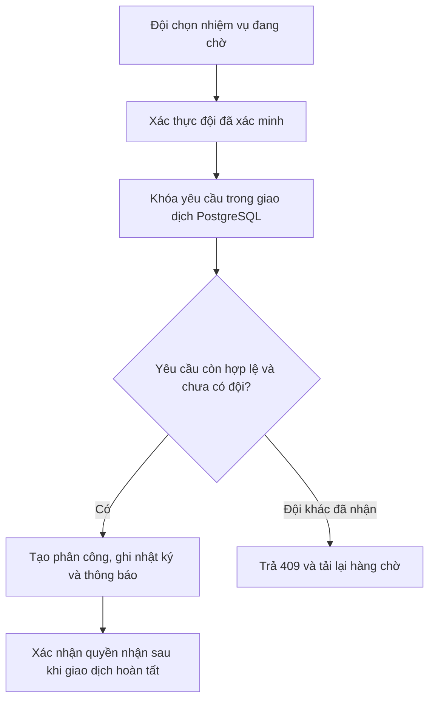

# Sprint 3 · Theo dõi và điều phối cứu trợ

Phạm vi gồm US-041–060, US-104 và US-108. API dùng các tài khoản, phiên, hồ sơ yêu cầu, lịch sử, thông báo và biên nhận thao tác sẵn có. Chạy `npm run migrate` với cơ sở dữ liệu của ứng dụng trước khi chạy backend. Migration 005 bổ sung tiến độ phân công, liên kết đơn chính và thông báo.

| US | Cách kiểm tra |
| --- | --- |
| 041 | Người dân vào **Yêu cầu → Tiến độ và lịch sử**, xem trạng thái đơn của mình. |
| 042 | Mở đúng mã từ danh sách, thấy dữ liệu gửi và tiến độ. Phiên khác truy cập mã trả 404. |
| 043 | Lọc trạng thái và xem các yêu cầu đã gửi từ mới đến cũ. Bản nháp tiếp tục ở màn hình cũ. |
| 044 | Đội đã xác minh xem hàng chờ hợp lệ. Đội bị khóa hoặc chưa duyệt bị chặn, đơn đã nhận biến mất. |
| 045 | Lọc theo nhu cầu, khẩn cấp và bán kính. Vị trí được xin khi chọn bộ lọc khoảng cách. |
| 046 | So số người và nhu cầu trên thẻ với dữ liệu yêu cầu. |
| 047 | Trước nhận, phản hồi chỉ chứa trường tóm tắt cho phép. API chi tiết từ chối đội chưa nhận. |
| 048 | Xem thông báo nhận, di chuyển, đến nơi và trả về chờ. Sự kiện hỗ trợ một phần và chuyển sang hoàn thành cũng tạo thông báo khi được ghi trên máy chủ. |
| 049 | Quản trị tìm theo mã/khu vực và lọc trạng thái. Quản trị thiếu quyền bị chặn. |
| 050 | Chọn đơn chờ và nhập mã đơn chính hợp lệ kèm lý do. Đơn phụ bị ẩn khỏi hàng chờ, chủ đơn giữ thông báo riêng. |
| 051 | Hai yêu cầu HTTP nhận đồng thời. PostgreSQL khóa cùng bản ghi. Một trả 201, một trả 409. |
| 052 | Đội thắng xem xác nhận và mở được chi tiết của phân công vừa nhận. |
| 053 | Đội thua thấy thông báo nhiệm vụ vừa được nhận, trở lại hàng chờ đã làm mới. |
| 054 | Tab nhiệm vụ đã nhận chỉ hiển thị công việc đội đang phụ trách. Lịch sử công việc đội thuộc US-088. |
| 055 | Đội phụ trách nhập lý do và trả trực tiếp nhiệm vụ về chờ. Lý do rỗng bị từ chối. |
| 056 | Quản trị nhận thông báo trả và thấy lý do trong lịch sử chi tiết, không có bước duyệt. |
| 057 | Quản trị chọn đội đủ điều kiện kèm lý do. Chuyển làm mất quyền của đội cũ và cấp quyền cho đội mới. |
| 058 | Kiểm tra chi tiết trước khi nhận, sau khi nhận và sau khi chuyển. Chỉ đội đang phụ trách thấy liên hệ. |
| 059 | Cập nhật từ đã nhận → đang di chuyển → đã đến nơi. Nhảy bước hoặc thao tác từ đội khác bị chặn. |
| 060 | Quản trị thấy đội hiện tại trong danh sách và chi tiết. Sau khi trả, đội phụ trách được gỡ. |
| 104 | Xem màn hình mới ở chiều rộng nhỏ và tăng cỡ chữ. Nhãn trạng thái bằng văn bản, nút nhận và nút mở chi tiết cao tối thiểu 48 dp. |
| 108 | Vào **Yêu cầu → Hướng dẫn cứu trợ**, xem các bước gửi và theo dõi. |

Các API mới nằm dưới `/api/v1/dispatch`. Quản trị dùng quyền `requests:read` để xem và `requests:review` để điều phối trong mô hình quyền hiện có. Các yêu cầu chỉ liên kết một tầng. Tên, điện thoại, địa chỉ và tọa độ chính xác bị loại khỏi hàng chờ. Khoảng cách tính theo đường chim bay và hiển thị làm tròn lên theo km. Các cập nhật phân công dùng mã thao tác và revision hiện tại.

Thông báo lưu trong app qua API `/notices`. US-048 dựa vào sự kiện `dispatch.partial` hoặc thay đổi trạng thái sang `completed` cho hai mốc tương ứng. Màn hình ghi nhận hỗ trợ một phần và chốt hoàn thành thuộc US-082–085, chưa triển khai trong sprint này.

Chạy `npm test` từ `Backend`. Ca tích hợp sprint 3 sử dụng PostgreSQL, hai phiên đội riêng biệt và cùng một mã yêu cầu. Ca này kiểm tra phân quyền, dữ liệu rút gọn, lọc, liên kết, nhận đồng thời, chuyển, trả, tiến độ và thông báo cho đơn liên kết.

Kiểm tra tại thời điểm bàn giao gồm 12/12 ca backend trên PostgreSQL và 48/48 ca Flutter trong nhóm test không cần SQLite native. Nhóm Flutter gồm hai widget test sprint 3 về màn hình hẹp, cỡ chữ, kích thước nút và hướng dẫn. Phân tích Dart ở các màn hình thay đổi không báo vấn đề. Bộ kiểm thử SQLite mã hóa và APK trên máy ảo Android chưa được xác nhận trong lượt này do môi trường Windows không chạy được bước biên dịch thư viện native.
