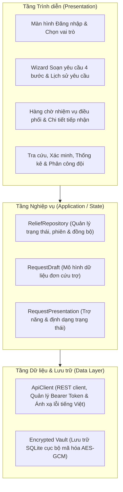

# Ứng dụng Cứu trợ Đồng bào Lũ lụt (Frontend Client)

Ứng dụng di động và web dành cho Người dân, Đội cứu hộ và Quản trị viên trong công tác tiếp nhận, điều phối và hỗ trợ khẩn cấp vùng thiên tai ngập lụt.

---

## 1. Kiến trúc Ứng dụng

Frontend được xây dựng trên nền tảng **Flutter 3.x (Dart 3)** theo mô hình kiến trúc phân lớp sạch (Clean Architecture) và thiết kế ưu tiên ngoại tuyến (**Offline-first**):



### Các tính năng kỹ thuật nổi bật
- **Lưu nháp an toàn cục bộ**: Sử dụng SQLite mã hóa AES-GCM với khóa lưu trong kho khóa hệ thống (`flutter_secure_storage`). Người dân không bị mất dữ liệu đang soạn thảo khi thiết bị mất nguồn hoặc mất mạng.
- **Định vị & Bản đồ hai chế độ (US-026)**: Tự động lấy tọa độ qua cảm biến GPS của thiết bị hoặc cho phép kéo ghim điều chỉnh trực quan trên bản đồ OpenStreetMap.
- **Trợ năng trong tình huống khẩn cấp (US-104)**: Kích thước vùng bấm phím chức năng luôn tối thiểu 48x48 pixel, chữ to rõ ràng, hỗ trợ mở rộng tỉ lệ văn bản (`textScaler`).
- **Xử lý xung đột điều phối mượt mà (US-053)**: Tự động chuyển đổi các mã lỗi API backend (`TASK_TAKEN`, `STALE_TASK`, `RATE_LIMITED`, `TASK_UNAVAILABLE`) thành thông điệp tiếng Việt thân thiện và kích hoạt tải lại danh sách nhiệm vụ tự động.

---

## 2. Hướng dẫn Khởi chạy trên Windows

### Cài đặt thư viện phụ thuộc
Trong thư mục `Frontend`, chạy lệnh:
```powershell
flutter pub get
```

### Kiểm tra tĩnh và chạy kiểm thử tự động
```powershell
flutter analyze
flutter test
```
*Ghi chú: Toàn bộ 49/49 bài test (bao gồm cả kiểm thử SQLite mã hóa thật trên Windows) đều phải vượt qua đạt 100%.*

### Chạy ứng dụng trên Trình duyệt Web (Chrome)
Phù hợp để kiểm tra nhanh giao diện và tính năng:
```powershell
flutter run -d chrome --web-port=8080 --dart-define=API_BASE_URL=http://127.0.0.1:3000/api/v1
```

### Chạy ứng dụng trên Máy ảo Android (Android Emulator)
Dành cho kiểm tra toàn diện camera, quyền GPS và lưu trữ SQLite native:
1. Mở Android Virtual Device (AVD) từ Android Studio.
2. Thực thi lệnh:
```powershell
flutter run --dart-define=API_BASE_URL=http://10.0.2.2:3000/api/v1
```
*(Lưu ý: Android Emulator truy cập dịch vụ đang chạy trên máy tính phát triển qua địa chỉ IP ảo đặc biệt `10.0.2.2` thay cho `127.0.0.1`).*
