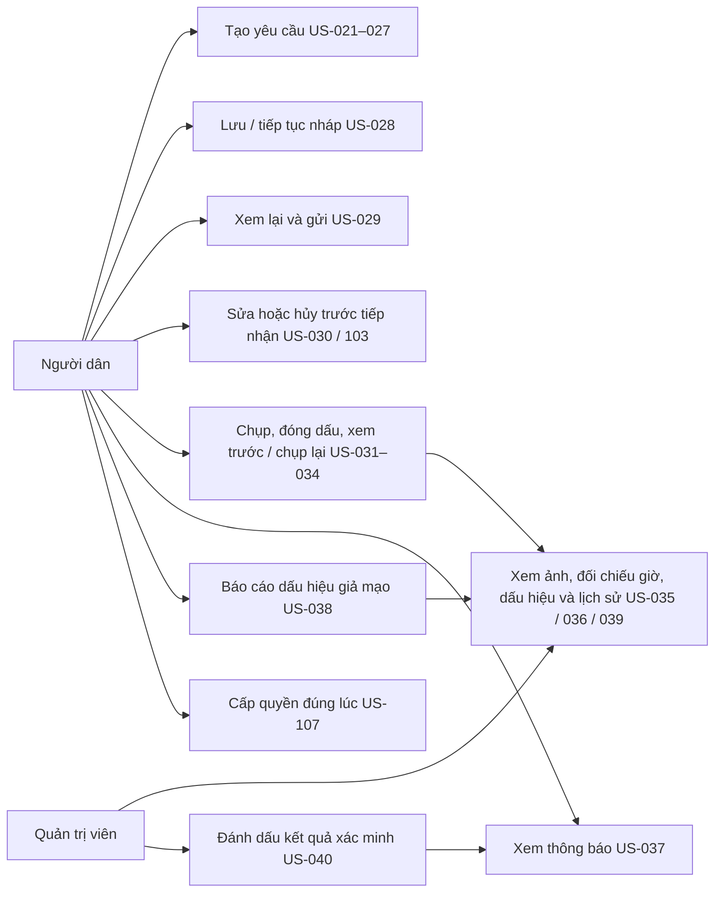
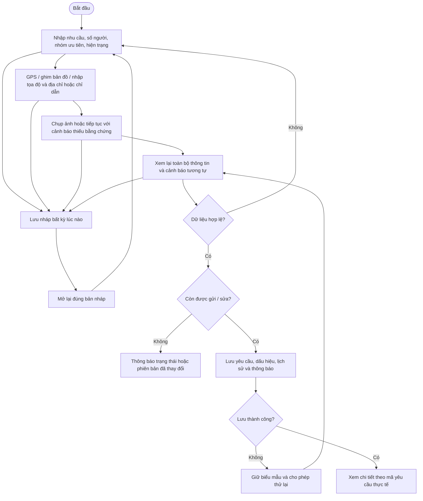
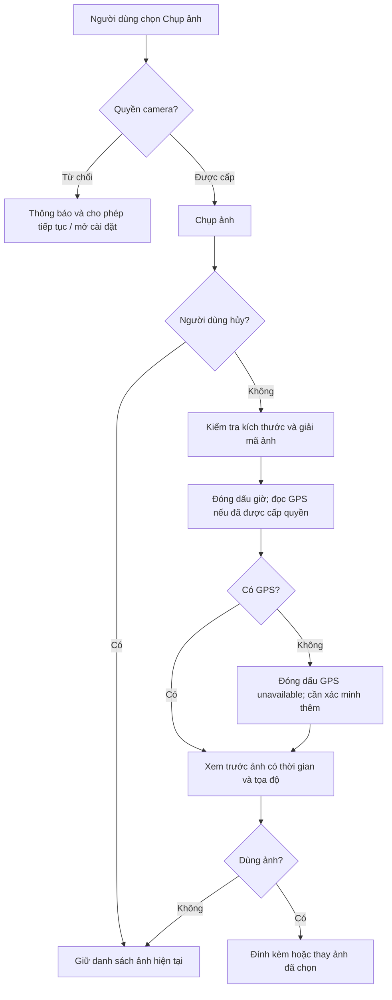
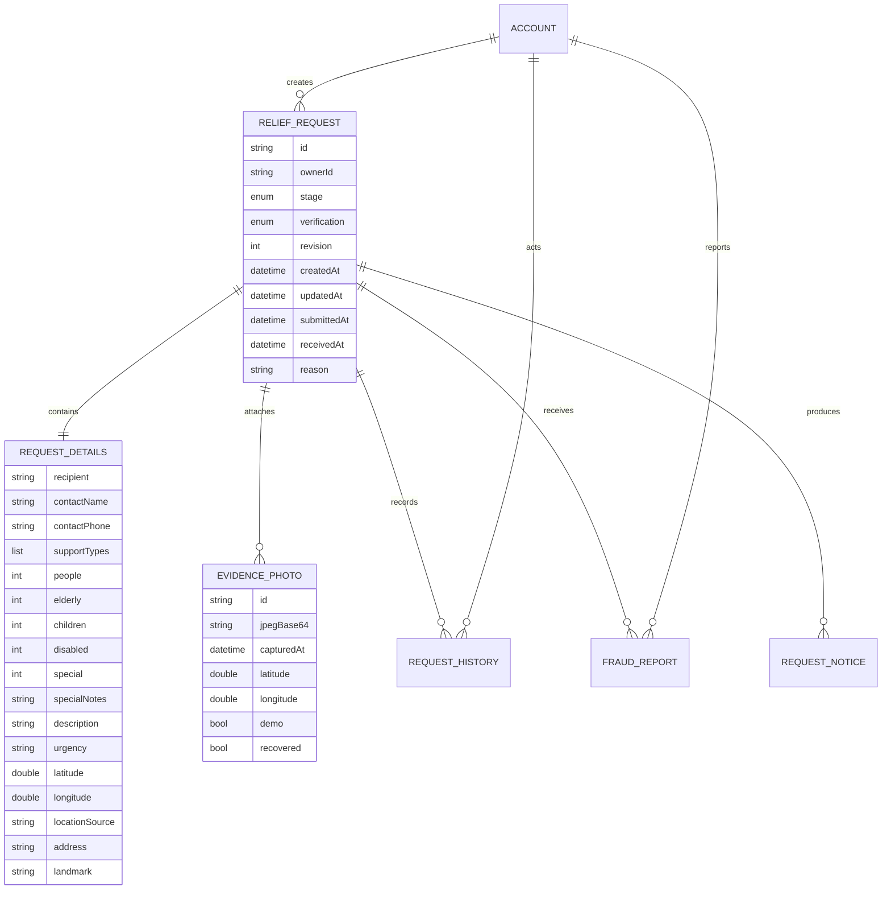

# Sprint 2 — yêu cầu cứu trợ và xác minh bằng chứng

## Phạm vi và cách chạy

Theo xác nhận của người dùng trong phiên làm việc: giữ dữ liệu mẫu, không xây backend mới. Các chức năng dưới đây chạy trong ứng dụng Flutter, dùng chung một kho dữ liệu mẫu lưu cục bộ bằng `shared_preferences`. Không gửi yêu cầu tới lực lượng cứu hộ thực tế. Mỗi thao tác chỉ báo thành công khi lưu thành công. Lỗi lưu không thay đổi dữ liệu đã công bố trên giao diện.

Chạy từ `Frontend`: `flutter pub get`, chạy `lib/main.dart` trên Android trong Android Studio, hoặc `flutter run -d chrome`. Dự án hiện tắt target Windows/Linux desktop qua cấu hình riêng trong pubspec để không bị dừng bước đăng ký plugin Android vì symlink desktop. Không thay đổi cài đặt Windows/toàn bộ Flutter SDK. Xem thêm `android-nghiep-vu-review.md` cho kết quả kiểm tra Android.

Dữ liệu ban đầu gồm CR-0247 đang chờ, CR-0189 và CR-0102 đã hoàn thành, cùng một bản nháp. Muốn gửi yêu cầu mới, hủy CR-0247 sau khi xác nhận hoặc cập nhật yêu cầu đó. Đây là quy tắc một yêu cầu đang hoạt động đã có trong giao diện ban đầu. Bản nháp vẫn có thể lưu khi đã có yêu cầu đang hoạt động.

Mở **Người dân → Yêu cầu** để tạo, xem, sửa, hủy, tiếp tục bản nháp và xem thông báo. Biểu tượng cờ cho phép báo cáo yêu cầu khác theo mã mà không mở thông tin riêng của người khác. Mở **Quản trị → Yêu cầu** để tìm kiếm, đọc bằng chứng, lịch sử và đánh dấu hợp lệ/cần bổ sung/không hợp lệ. Hai giao diện đọc cùng dữ liệu trên cùng thiết bị/trình duyệt. Chuyển vai trò bằng luồng đăng nhập mẫu sẵn có. Không cần tạo tài khoản mới. Kho mẫu cũng giữ CR-0251, CR-0238, CR-0199 của màn hình quản trị ban đầu, gán cho các định danh mẫu khác nhau.

Không chỉnh sửa mã đăng ký, đăng nhập, OTP, mật khẩu, hồ sơ cá nhân, đăng ký đội, duyệt đội, đình chỉ đội hoặc màn hình SMS/xử lý kết nối. Trang chủ chỉ thay phần hiển thị yêu cầu/bản nháp cứng bằng dữ liệu chung; khối ngoại tuyến cũ được giữ nguyên.

## Quy tắc nghiệp vụ

- Người dân chỉ đọc/sửa yêu cầu của định danh mẫu của mình. Chỉ quản trị viên xác minh. Đây là kiểm tra vai trò của bản mẫu; chưa phải bảo mật tài khoản ở máy chủ.
- Mỗi người có tối đa một yêu cầu chưa hoàn tất. Yêu cầu bị xác minh không hợp lệ không chiếm suất đang hoạt động. Không có quy tắc tự chặn yêu cầu của người khác vì ở cùng vị trí.
- Một yêu cầu có nhiều loại hỗ trợ. Tổng số người từ 1–10.000. Mỗi nhóm ưu tiên từ 0 đến tổng số người; tổng người cao tuổi và trẻ em không vượt tổng. Người khuyết tật/cần chăm sóc đặc biệt có thể thuộc các nhóm khác. Có người cần chăm sóc đặc biệt thì phải mô tả nhu cầu.
- Phải chọn một mức khẩn cấp đầy đủ: Khẩn cấp, Cao hoặc Trung bình. Phải nhập mô tả hiện trạng. Không cắt chuỗi “Khẩn cấp” thành “Khẩn”.
- Tọa độ hợp lệ gồm cả 0,0, trong miền vĩ độ [-90,90], kinh độ [-180,180]. Phải có địa chỉ hoặc chỉ dẫn nhận diện. Ghim bản đồ/nhập tọa độ không được gắn nhãn là đo GPS.
- Bản nháp chấp nhận thông tin chưa đầy đủ. Lưu lại đúng mã bản nháp; khi gửi chuyển chính bản đó thành yêu cầu đang chờ, không tạo hai bản ghi.
- Xem lại đủ người liên hệ, loại hỗ trợ, số người, các nhóm ưu tiên, chăm sóc, mô tả, mức khẩn cấp, vị trí, địa chỉ, chỉ dẫn và ảnh trước khi gửi. Quay lại sửa không làm mất dữ liệu các bước khác.
- Chỉ chủ yêu cầu được sửa trước khi đội tiếp nhận. Sửa nội dung đã gửi đưa kết quả xác minh về chờ xác minh lại; quyết định cũ vẫn ở lịch sử. Không sửa yêu cầu đã bị kết luận không hợp lệ.
- Hủy chỉ áp dụng trước khi tiếp nhận, có hộp thoại xác nhận. Bấm giữ yêu cầu/đóng hộp thoại không thay dữ liệu. Hủy là trạng thái kết thúc, không xóa lịch sử.
- Tối đa 5 ảnh. Ảnh đầu vào tối đa 10 MB; ảnh sau xử lý tối đa 1 MB, JPEG, có dải dấu giờ UTC và tọa độ ghi vào pixel. Ảnh quá nhỏ/hỏng bị từ chối. Xem trước và đồng ý mới đính kèm; chụp lại thay một ảnh thay vì thêm bản trùng.
- Thiếu ảnh/GPS không ngăn gửi yêu cầu khẩn cấp: lưu dấu hiệu và thông báo cần xác minh thêm. Không dùng tọa độ ghim bản đồ để giả làm GPS của ảnh. Ảnh mẫu luôn mang dấu DEMO và dấu hiệu cần xác minh.
- Cảnh báo ảnh lệch quá 10 phút so với tiếp nhận mô phỏng; vị trí ảnh lệch quá 500 m; yêu cầu đang hoạt động có cùng nội dung chuẩn hóa, độ giao tập từ ít nhất 65% (mỗi nội dung ít nhất 4 từ khác nhau), hoặc vị trí trong 100 m. Đây là các ngưỡng cấu hình mẫu trong mã, chưa phải quy tắc đã được người dùng phê duyệt cho hệ thống thật.
- Chỉ quản trị viên kết luận hợp lệ/cần bổ sung/không hợp lệ. Cần bổ sung và không hợp lệ bắt buộc có lý do. Mọi quyết định tạo lịch sử và thông báo cho chủ yêu cầu.
- Báo cáo giả mạo cần lý do; mỗi định danh mẫu báo cáo một lần cho mỗi yêu cầu. Báo cáo chỉ tạo dấu hiệu kiểm tra, không tự kết luận giả mạo.
- Không xin quyền khi khởi động hoặc mở màn hình. Xin vị trí khi bấm GPS, camera khi bấm chụp, thông báo khi bấm cho phép thông báo hệ thống. Không xin vị trí nền, microphone hoặc quyền lưu trữ rộng. Từ chối thông báo không làm mất thông báo trong ứng dụng.
- Các thao tác dùng số phiên bản để phát hiện dữ liệu cũ, đọc lại trạng thái trước khi lưu và khóa thao tác đang lưu, tránh bấm gửi hai lần/ghi đè bản cập nhật mới.

## Use Case

## Activity tạo / cập nhật yêu cầu

## Activity chụp ảnh

## Mô hình dữ liệu và trạng thái

Đây là ERD nghiệp vụ mở rộng, chưa tạo bảng tài khoản/đội hoặc migration của sprint trước. Trong bản mẫu, các thực thể yêu cầu được lưu trong một JSON snapshot cục bộ.

Trạng thái xử lý: `draft → waiting → accepted → completed`; `waiting → cancelled`. Sprint này chỉ triển khai luồng nháp/chờ/hủy; tiếp nhận được mô phỏng ở lớp dữ liệu để kiểm thử điều kiện chặn sửa/hủy. Chưa triển khai điều phối và hoàn thành nhiệm vụ của sprint sau.

Kết quả xác minh độc lập: `pending → valid | needsInfo | invalid`. Khi chủ yêu cầu sửa/bổ sung hợp lệ trong lúc chờ tiếp nhận: quay về `pending`, thêm lịch sử, giữ các thông báo trước đó. Đánh dấu không hợp lệ không bị nhầm thành hủy bởi người dân.

## Review từng US

Mỗi dòng dưới đây ghi lại kiểm tra nghiệp vụ riêng. Các kiểm thử có tên US tương ứng trong `test/requests`; không coi kiểm thử mô phỏng là kiểm thử phần cứng thật.

| US | Kết quả triển khai và điểm review |
|---|---|
| US-021 | Tạo/lưu yêu cầu theo mã động, lịch sử; từ chối dữ liệu thiếu, không tạo bản ghi khi lỗi lưu. Có Use Case, Activity và ERD ở trên. |
| US-022 | Chọn một/nhiều loại trong 5 loại; kiểm tra rỗng và loại không hợp lệ. |
| US-023 | Tổng số người nguyên dương, kiểm tra 0, âm, vượt giới hạn. |
| US-024 | Lưu đủ 4 nhóm; kiểm tra từng nhóm, cho phép giao nhau và yêu cầu ghi chú chăm sóc. |
| US-025 | Mô tả bắt buộc, mức khẩn cấp dùng đầy đủ nhãn và được giữ qua các bước. |
| US-026 | GPS thật khi được cấp quyền, ghim bản đồ, nhập tọa độ hoặc chọn mẫu rõ nhãn; kiểm tra biên/NaN/thiếu. |
| US-027 | Địa chỉ hoặc hướng dẫn nhận diện; không chấp nhận cả hai trắng. |
| US-028 | Nháp thiếu thông tin được lưu cục bộ, mở lại qua kho mới, giữ mã và các trường đã nhập. |
| US-029 | Xem lại toàn bộ thông tin, ảnh và cảnh báo; bản sao không làm thay đổi dữ liệu đã lưu. |
| US-030 | Kiểm tra chủ sở hữu/trạng thái/phiên bản; sửa trước tiếp nhận, chặn sửa và hủy sau tiếp nhận. |
| US-031 | Camera thật trên nền tảng hỗ trợ, lỗi quyền/hủy chụp/tệp lỗi được xử lý; có ảnh mẫu riêng. Có Activity chụp ảnh. |
| US-032 | Giờ UTC và tọa độ ghi vào pixel, lưu metadata đi kèm; kiểm thử giải mã ảnh kết quả. |
| US-033 | Xem trước, giữ/bỏ ảnh, thay ảnh và xóa; kiểm tra không thay đổi snapshot đã lưu. |
| US-034 | Thiếu GPS/camera có thông báo; thiếu bằng chứng vẫn gửi với dấu hiệu cần xác minh. |
| US-035 | Hiển thị giờ thiết bị, tiếp nhận mô phỏng, chênh giờ từng ảnh; chưa có giờ máy chủ thật. |
| US-036 | Cảnh báo vị trí trong 100 m hoặc nội dung gần giống; loại yêu cầu đã kết thúc/không hợp lệ, không kết luận tự động. |
| US-037 | Thông báo tự động khi cần xác minh thêm và khi quản trị yêu cầu bổ sung; lưu cùng yêu cầu. |
| US-038 | Báo cáo có lý do, chống báo cáo lặp; không tự đổi kết quả thành không hợp lệ. |
| US-039 | Đọc ảnh/lịch sử/dấu hiệu; kiểm tra vai trò mẫu và snapshot không sửa được kho. |
| US-040 | Chỉ quản trị xác minh; cần lý do cho bổ sung/không hợp lệ, có lịch sử và thông báo. |
| US-103 | Hộp thoại giữ/hủy; không có xác nhận thì kho từ chối hủy, xác nhận mới chuyển trạng thái. |
| US-107 | Không xin quyền khi mở màn hình; thao tác nào xin quyền đó; từ chối không làm mất luồng mẫu. |

## Giới hạn cần kiểm chứng trên thiết bị

- GPS và camera cần điện thoại/quyền thực tế. Desktop chưa có camera delegate nên hiển thị thông báo hỗ trợ; có nút dùng ảnh mẫu. Trên web, bộ chọn ảnh phụ thuộc khả năng trình duyệt và không chứng minh ảnh được chụp trực tiếp.
- `receivedAt` hiện dùng đồng hồ thiết bị để mô phỏng; không có nguồn giờ độc lập nên không thể phát hiện việc chỉnh đồng hồ thiết bị. Khi tích hợp backend phải thay nguồn này bằng thời điểm server tiếp nhận. Dấu ảnh/metadata không chống được giả mạo có chủ ý.
- Thông báo hiện lưu và hiển thị trong ứng dụng. Nút xin quyền hệ thống chưa đồng nghĩa đã có dịch vụ push hoặc thông báo nền.
- Quyền sở hữu dùng định danh mẫu, không tích hợp token của hệ thống xác thực thật vì checkout này chưa có API và người dùng yêu cầu giữ mẫu. Cần xác thực và kiểm tra quyền lại ở server khi đưa vào sử dụng thật.
- Bản đồ OpenStreetMap cần Internet để tải nền. Tọa độ/GPS và bản nháp không phụ thuộc tải nền thành công.
- `shared_preferences` phục vụ bản mẫu, không phải kho bằng chứng cứu trợ chính thức. Không dùng chế độ mẫu cho vận hành thật.

Tham khảo tích hợp plugin: [image_picker](https://pub.dev/packages/image_picker), [permission_handler](https://pub.dev/packages/permission_handler), [geolocator](https://pub.dev/packages/geolocator), [flutter_map](https://pub.dev/packages/flutter_map).

## Kết quả kiểm tra tự động

- `flutter analyze --no-pub`: **không có lỗi hoặc cảnh báo**.
- `flutter test --no-pub`: bộ mở rộng **40 kiểm thử**, gồm kiểm thử khởi động sẵn có, validation, lưu/mở lại nháp, quyền sở hữu mẫu, trạng thái, lỗi ghi dữ liệu, ảnh/đóng dấu, màn hình rộng 360, nội dung gần giống, khôi phục camera, Back Android và quản trị yêu cầu bổ sung qua giao diện. Kết quả Android mới nhất nằm trong `android-nghiep-vu-review.md`.
- `flutter build web --no-pub`: **thành công**, gồm Wasm dry run.
- Đã build APK và thử trên Android emulator; chưa chạy iOS hoặc điện thoại thật. Không đánh đồng các thử nghiệm này với việc đã xác nhận push hoặc máy chủ thật.

Các tệp kiểm thử mới: `test/requests/request_creation_test.dart`, `request_location_draft_test.dart`, `request_evidence_review_test.dart`, `request_ui_test.dart`. Những lỗi phát hiện trong vòng review (truyền thiếu nhóm ưu tiên, nhãn khẩn cấp bị cắt, dữ liệu danh sách không đồng bộ, hủy chỉ đổi giao diện, vòng tải khi xem trước ảnh, vòng đời ô nhập lý do xác minh) được xử lý trong phần yêu cầu mới; không sửa các module sprint trước.
