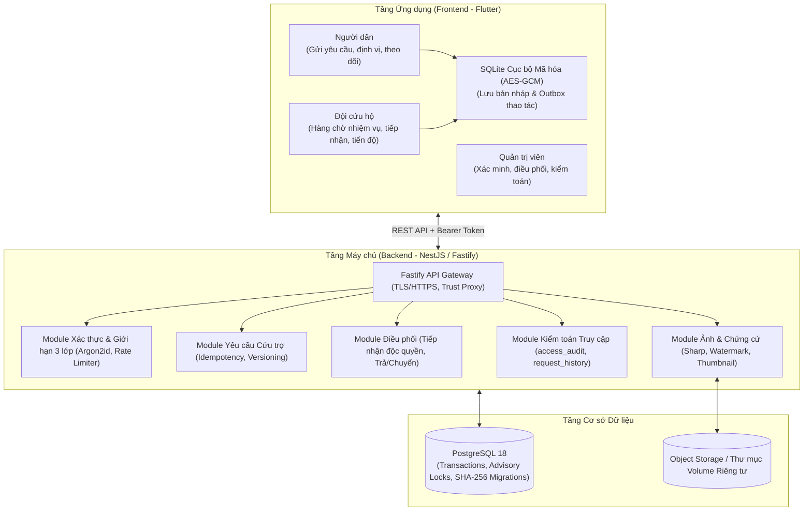

# Hệ thống Ứng dụng Cứu trợ Đồng bào Lũ lụt

Hệ thống điều phối cứu trợ lũ lụt đa nền tảng kết nối Người dân gặp nạn, Đội cứu hộ thực địa và Quản trị viên điều phối trong điều kiện thiên tai khẩn cấp và mạng yếu.

---

## 1. Kiến trúc Tổng thể Hệ thống

Hệ thống được thiết kế theo mô hình 3 tầng hiện đại, chú trọng tính chịu lỗi, bảo vệ dữ liệu cá nhân và hoạt động ngoại tuyến (Offline-first):

### Các đặc điểm kiến trúc trọng yếu
1. **Bảo vệ quyền riêng tư vị trí & số điện thoại (US-047, US-102)**: Trong danh sách nhiệm vụ chờ (`mode=waiting`), tọa độ được làm tròn 2 chữ số thập phân, che giấu số điện thoại và địa chỉ cụ thể. Chỉ khi đội cứu hộ tiếp nhận chính thức hoặc admin xem xét, thông tin liên hệ mới được giải mã và ghi nhật ký truy cập kiểm toán (`access_audit`).
2. **Tiếp nhận độc quyền và xử lý xung đột (US-051 – US-053)**: Cơ chế khóa dòng giao dịch (`SELECT ... FOR UPDATE`) cùng kiểm tra phiên bản (`If-Match / revision`) ngăn chặn triệt để tình trạng hai đội cùng tiếp nhận một nhiệm vụ. Đội chậm hơn nhận mã lỗi 409 `TASK_TAKEN` và ứng dụng tự động tải lại danh sách.
3. **Chống giả mạo và bảo toàn dữ liệu**: Đóng dấu watermark thời gian thiết bị và tọa độ tham chiếu vào ảnh hiện trường; tách biệt thời gian thiết bị khai báo và thời gian máy chủ ghi nhận; trigger CSDL ngăn chặn sửa đổi lịch sử xử lý.
4. **Bảo vệ chống từ chối dịch vụ (Rate Limiting)**: Bảo vệ 3 lớp: Giới hạn theo IP, Giới hạn theo cặp (SĐT + IP) để chống Account Lockout DoS, và Ngưỡng chặn phân tán theo SĐT chống botnet.

---
### Yêu cầu môi trường
- Hệ điều hành: Windows 10/11 x64
- Node.js: Phiên bản 24.x (kèm npm)
- Flutter SDK: Phiên bản 3.x (kèm Dart)
- PostgreSQL: Phiên bản 18 >

