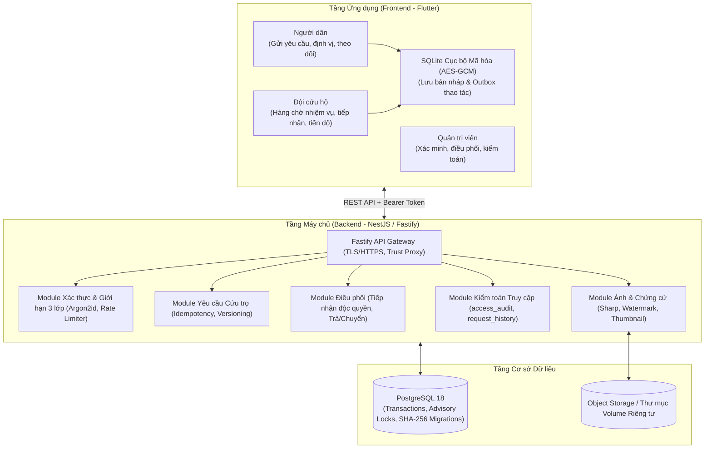

# Hệ thống Ứng dụng Cứu trợ Đồng bào Lũ lụt

Hệ thống điều phối cứu trợ lũ lụt đa nền tảng kết nối Người dân gặp nạn, Đội cứu hộ thực địa và Quản trị viên điều phối trong điều kiện thiên tai khẩn cấp và mạng yếu.

---

## 1. Kiến trúc Tổng thể Hệ thống

Hệ thống được thiết kế theo mô hình 3 tầng hiện đại, chú trọng tính chịu lỗi, bảo vệ dữ liệu cá nhân và hoạt động ngoại tuyến (Offline-first):



### Các đặc điểm kiến trúc trọng yếu
1. **Bảo vệ quyền riêng tư vị trí & số điện thoại (US-047, US-102)**: Trong danh sách nhiệm vụ chờ (`mode=waiting`), tọa độ được làm tròn 2 chữ số thập phân, che giấu số điện thoại và địa chỉ cụ thể. Chỉ khi đội cứu hộ tiếp nhận chính thức hoặc admin xem xét, thông tin liên hệ mới được giải mã và ghi nhật ký truy cập kiểm toán (`access_audit`).
2. **Tiếp nhận độc quyền và xử lý xung đột (US-051 – US-053)**: Cơ chế khóa dòng giao dịch (`SELECT ... FOR UPDATE`) cùng kiểm tra phiên bản (`If-Match / revision`) ngăn chặn triệt để tình trạng hai đội cùng tiếp nhận một nhiệm vụ. Đội chậm hơn nhận mã lỗi 409 `TASK_TAKEN` và ứng dụng tự động tải lại danh sách.
3. **Chống giả mạo và bảo toàn dữ liệu**: Đóng dấu watermark thời gian thiết bị và tọa độ tham chiếu vào ảnh hiện trường; tách biệt thời gian thiết bị khai báo và thời gian máy chủ ghi nhận; trigger CSDL ngăn chặn sửa đổi lịch sử xử lý.
4. **Bảo vệ chống từ chối dịch vụ (Rate Limiting)**: Bảo vệ 3 lớp: Giới hạn theo IP, Giới hạn theo cặp (SĐT + IP) để chống Account Lockout DoS, và Ngưỡng chặn phân tán theo SĐT chống botnet.

---

## 2. Hướng dẫn Chạy trên Windows

### Yêu cầu môi trường
- Hệ điều hành: Windows 10/11 x64
- Node.js: Phiên bản 24.x (kèm npm)
- Flutter SDK: Phiên bản 3.x (kèm Dart)
- PostgreSQL: Phiên bản 18 (hoặc dịch vụ PostgreSQL cục bộ lắng nghe cổng 5432)

---

### Khởi chạy Backend

1. Mở PowerShell và di chuyển vào thư mục `Backend`:
   ```powershell
   cd F:\DACN\Backend
   npm ci
   ```
2. Cấu hình biến môi trường kiểm thử/chạy:
   ```powershell
   # Tạo database dacn_test trong PostgreSQL của bạn nếu chưa có
   $env:TEST_DATABASE_URL = "postgresql://postgres:<mat_khau>@127.0.0.1:5432/dacn_test"
   ```
3. Chạy kiểm thử tự động toàn bộ Backend:
   ```powershell
   npm test
   ```
4. Khởi chạy máy chủ phát triển (Development Server):
   ```powershell
   npm run dev
   ```
   Máy chủ sẽ lắng nghe tại `http://127.0.0.1:3000`.

---

### Khởi chạy Frontend (Ứng dụng "Cứu trợ đồng bào lũ lụt")

1. Mở một cửa sổ PowerShell mới và di chuyển vào thư mục `Frontend`:
   ```powershell
   cd F:\DACN\Frontend
   flutter pub get
   ```
2. Chạy phân tích mã nguồn và kiểm thử tự động:
   ```powershell
   flutter analyze
   flutter test
   ```
3. Khởi chạy ứng dụng kiểm thử trên Trình duyệt Web (Chrome):
   ```powershell
   flutter run -d chrome --web-port=8080 --dart-define=API_BASE_URL=http://127.0.0.1:3000/api/v1
   ```
4. Khởi chạy trên Máy ảo Android (Android Emulator):
   *(Đảm bảo đã mở sẵn Android Emulator trong Android Studio)*
   ```powershell
   flutter run --dart-define=API_BASE_URL=http://10.0.2.2:3000/api/v1
   ```
   *(Địa chỉ `10.0.2.2` là alias mặc định của Android Emulator để trỏ tới `localhost` của máy tính Windows).*

---

## 3. Tài liệu Tham khảo Liên quan

- Chi tiết hiện trạng từng User Story: [docs/implementation-status.md](docs/implementation-status.md)
- Báo cáo kết quả kiểm thử tự động: [docs/testing.md](docs/testing.md)
- Danh mục dữ liệu cá nhân & Căn cứ pháp lý: [docs/privacy/data-inventory.md](docs/privacy/data-inventory.md)
- Báo cáo Sprint 3 Review & Retrospective: [docs/scrum/sprint-3-review.md](docs/scrum/sprint-3-review.md)
